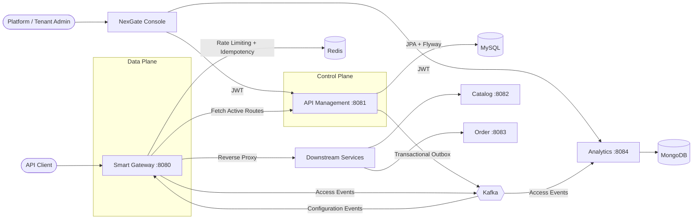

# NexGate

**A multi-tenant API gateway and API management platform built with Java 21, Spring Boot 3 and React.**

NexGate lets platform operators onboard organizations, and lets each organization publish and govern its own API routes: authentication, role-based access, rate limiting, idempotency, timeouts, path rewriting and header transformation. Every route change is versioned, audited and pushed to the running gateway in near real time, without a restart.

**Live console:** https://nex-gate.dev/

## Demo Account

Explore the NexGate Console using the following demo credentials:

| Field | Value |
|---|---|
| Username | `demouser1` |
| Password | `demouser1` |

**Login:** https://nex-gate.dev/

> This account is intended for demonstration and evaluation purposes. Do not use it for sensitive activities.

---

## Table of Contents

- [Highlights](#highlights)
- [Architecture](#architecture)
- [Features](#features)
  - [Smart Gateway](#smart-gateway-data-plane)
  - [API Management](#api-management-control-plane)
  - [Analytics](#analytics)
  - [NexGate Console](#nexgate-console-web-ui)
  - [Demo Services](#demo-services)
- [Roles and Access](#roles-and-access)
- [Tech Stack](#tech-stack)
- [Getting Started](#getting-started)
- [End-to-End Walkthrough](#end-to-end-walkthrough)
- [API Reference](#api-reference)
- [Configuration](#configuration)
- [Testing](#testing)
- [Project Structure](#project-structure)
- [Known Limitations](#known-limitations)
- [Author](#author)

---

## Highlights

- **Dynamic routing** with exact, path-variable and wildcard patterns, resolved by specificity.
- **Per-route policies** configured from the UI or API: JWT authentication, role-based authorization, Redis rate limiting, POST idempotency, timeouts, path rewriting and header transformation.
- **Hot configuration reload:** route changes propagate through Kafka without restarting the Gateway.
- **Multi-tenancy:** strict tenant isolation enforced server-side.
- **Route version history:** immutable configuration snapshots, field-level comparison and one-click restore.
- **Audit trail:** administrative route operations are recorded.
- **Event-driven analytics:** Gateway access events are processed asynchronously and stored in MongoDB.
- **Concurrency safety:** atomic Redis operations for rate limiting and idempotency.
- **Test coverage:** backend unit and integration tests, plus 86 frontend tests.

---

## Architecture

NexGate separates the **control plane**, where routes are defined and governed, from the **data plane**, where incoming API traffic is processed.



### Service Responsibilities

| Module | Port | Responsibility | Data Store |
|---|---:|---|---|
| API Management Service | 8081 | Authentication, organizations, tenant administrators, routes, policies, versions and auditing | MySQL |
| Smart Gateway Service | 8080 | Routing, authentication, authorization, rate limiting, idempotency and reverse proxying | Redis and in-memory route registry |
| Analytics Service | 8084 | Kafka event consumption and traffic statistics | MongoDB |
| Catalog Service | 8082 | Demo product API | In memory |
| Order Service | 8083 | Demo order API | In memory |
| Frontend | 5173 | React administration console | — |
| Common | — | Shared event contracts | — |

### Configuration Update Flow

1. An administrator creates or updates a route through API Management.
2. The route update, version snapshot and transactional outbox event are persisted in the same database transaction.
3. The outbox publisher sends pending events to Kafka.
4. Smart Gateway receives a configuration-change notification.
5. Gateway fetches the latest authoritative route configuration from API Management.
6. The route registry is validated and atomically replaced without restarting the service.

MySQL remains the source of truth. Kafka notifications trigger refreshes but do not carry the authoritative route configuration.

---

## Features

### Smart Gateway (Data Plane)

#### Dynamic Routing

- Matches incoming HTTP requests against an in-memory route registry.
- Supports exact paths, path variables and wildcard patterns.
- Supports:
  - Exact: `/orders/list`
  - Path variable: `/orders/{id}`
  - Single-segment wildcard: `/orders/*`
  - Multi-segment wildcard: `/orders/**`
- Uses route specificity when multiple routes match.
- Distinguishes between:
  - `404 ROUTE_NOT_FOUND`
  - `405 METHOD_NOT_ALLOWED`
- Rejects duplicate method-and-path registrations during configuration loading.

#### Path Transformation

- Configurable prefix stripping.
- Configurable path rewriting.
- Safe joining of target base paths.
- Preserves query parameters.

#### JWT Authentication and Authorization

- Validates HS256 JWT tokens locally.
- Checks token signature, expiration, issuer and subject.
- Extracts roles from `role` and `roles` claims.
- Supports public and protected routes.
- Enforces route-level permitted roles.
- Avoids authentication-service network calls for every request.

#### Redis Rate Limiting

- Distributed fixed-window rate limiting.
- Atomic Redis Lua script execution.
- Configurable request limits and time windows.
- Supported scopes:
  - `ROUTE`
  - `USER`
  - `TENANT`
  - `IP`
- Returns `429 RATE_LIMIT_EXCEEDED` with a `Retry-After` header.
- Fails closed when Redis is unavailable.

#### POST Idempotency

- Configurable idempotency for POST routes.
- Requires an `Idempotency-Key` header.
- Stores processing state and completed responses in Redis.
- Replays previously completed responses for matching requests.
- Detects concurrent duplicate requests.
- Rejects reuse of the same key with a different payload.
- Uses configurable TTL, defaulting to 24 hours.
- Releases the key after downstream failures so clients can retry.

#### Header Transformation

Supports request and response header rules:

- `ADD`
- `MODIFY`
- `REMOVE`
- `FORWARD`

Security protections:

- Hop-by-hop headers are stripped.
- `Authorization` and `Cookie` are not forwarded downstream.
- Header rules targeting `Authorization`, `Cookie` or `Set-Cookie` are rejected.

#### Resilience and Error Handling

- Configurable per-route downstream timeouts.
- Connection-failure handling.
- Downstream error handling.
- Structured JSON error responses.
- Last-known-good route registry.
- Configuration version checks.
- Duplicate and out-of-order notification handling.
- Startup route loading with retries.

#### Observability

- Correlation ID generation and propagation.
- Kafka-based access-event publishing.
- Request outcome and latency tracking.
- Route registry health indicators.
- Kafka refresh health indicators.

---

### API Management (Control Plane)

#### Authentication

- JWT issuance using HS256.
- BCrypt password hashing.
- Stateless authentication.
- Configurable token lifetime.
- Organization-aware tenant login.
- Suspended organizations cannot authenticate.

#### Organization Management

Platform administrators can:

- Create organizations.
- List and view organizations.
- Update organization details.
- Activate or suspend organizations.
- Soft-delete organizations.
- Manage tenant administrators.

Organization lifecycle:

- `PENDING`
- `ACTIVE`
- `SUSPENDED`
- `DELETED`

Each organization has a unique lowercase slug.

#### Tenant Administrator Management

Platform administrators can:

- Create tenant administrators.
- View administrator details.
- Update administrator information.
- Enable or disable accounts.
- Delete tenant administrators.

#### Route Management

Tenant administrators can manage routes belonging to their organization.

Supported operations:

- Create routes.
- View routes.
- Update route configurations.
- Activate and deactivate routes.
- Soft-delete routes.
- Configure allowed HTTP methods.
- Configure target URIs.
- Configure route policies.

#### Route Policies

Each route can define:

- Authentication requirements.
- Permitted roles.
- Rate-limit configuration.
- Rate-limit scope.
- Upstream timeout.
- POST idempotency.
- Path rewriting.
- Request header transformations.
- Response header transformations.

#### Versioning

Every route modification creates an immutable configuration snapshot.

Supported operations:

- View version history.
- Inspect individual snapshots.
- Compare two versions.
- Restore an earlier configuration.

A restore creates a new version rather than modifying historical records.

#### Tenant Isolation

- Tenant administrators can access only their organization's routes.
- Organization identity is derived from the JWT `organizationId` claim.
- Cross-tenant access is rejected server-side.
- Platform administrators can inspect routes across organizations.
- Tenant-level permissions are enforced by Spring Security.

#### Transactional Outbox

Route modifications and configuration events are recorded atomically.

The scheduled publisher:

- Reads pending outbox records.
- Publishes events to Kafka.
- Retries failed publications.
- Marks events as failed after the configured retry limit.

#### Administrative Auditing

Spring AOP-based auditing records:

- Actor
- Action
- Resource
- Operation result
- Duration
- Timestamp

---

### Analytics

Analytics Service consumes Gateway access events from Kafka and stores them in MongoDB.

Features:

- Asynchronous event processing.
- Event deduplication using `eventId`.
- Unique event index.
- Request statistics.
- Success and failure tracking.
- Average response-time calculation.
- Slow-route identification.
- Rate-limit rejection tracking.
- Idempotency replay tracking.

Available endpoints:

| Endpoint | Description |
|---|---|
| `GET /api/analytics/summary` | Total, successful and failed requests, average response time |
| `GET /api/analytics/routes` | Per-route request count and average response time |
| `GET /api/analytics/slow-routes?limit=10` | Slowest routes by average response time |
| `GET /api/analytics/rate-limit-rejections` | Rate-limit rejection count |
| `GET /api/analytics/idempotency-replays` | Idempotency replay count |

Analytics endpoints are restricted to `PLATFORM_ADMIN`.

---

### NexGate Console (Web UI)

A React-based administration console with role-specific navigation.

#### Platform Admin

- Platform overview.
- Organization management.
- Organization status management.
- Tenant administrator management.
- Read-only route oversight across organizations.
- Route configuration version index.
- Platform-wide analytics.
- Service health dashboard.
- Infrastructure health dashboard.
- Audit and settings pages.

#### Tenant Admin

- Tenant overview.
- Route management.
- Route creation and editing.
- Route activation and deactivation.
- Route deletion.
- Visual route-processing pipeline.
- Route policy editor.
- Version history.
- Configuration comparison.
- Configuration restoration.
- Organization details.

#### Console Features

- Light, dark and system themes.
- React Hook Form and Zod validation.
- TanStack Query for server-state management.
- Role-based navigation.
- Session expiry warnings.
- JWT stored in `sessionStorage`.
- No JWT storage in `localStorage`.
- Query cache cleared on sign-out.
- Honest unavailable-feature states instead of fabricated data.

Spring Security remains the actual authorization boundary. Frontend role guards are not a substitute for backend authorization.

---

### Demo Services

Two lightweight downstream services demonstrate Gateway forwarding.

#### Catalog Service — Port 8082

- List products.
- Fetch individual products.
- Create products.
- Simulate slow responses.

#### Order Service — Port 8083

- Create orders.
- List orders.
- Fetch individual orders.
- Simulate slow responses.

These services demonstrate:

- Reverse proxying.
- Route-level policies.
- Path rewriting.
- Timeout handling.
- POST idempotency.

---

## Roles and Access

| Role | Purpose | Access |
|---|---|---|
| `PLATFORM_ADMIN` | Operates the platform | Platform administration, cross-organization route oversight and analytics |
| `TENANT_ADMIN` | Manages one organization | Own organization's route management |
| `GATEWAY_SERVICE` | Gateway service account | Active route configuration endpoint |
| `USER` | Application user | Depends on configured route policies |
| `ADMIN` | Application administrator | Depends on configured route policies |

Route-level permitted roles can include:

- `PLATFORM_ADMIN`
- `TENANT_ADMIN`
- `GATEWAY_SERVICE`
- `USER`
- `ADMIN`

---

## Tech Stack

| Layer | Technology |
|---|---|
| Language | Java 21 |
| Backend Framework | Spring Boot 3.5 |
| Security | Spring Security, OAuth2 Resource Server, JWT |
| Persistence | Spring Data JPA, Spring Data MongoDB |
| Database | MySQL 8.4, MongoDB 7 |
| Cache and Distributed State | Redis 7.4 |
| Messaging | Apache Kafka, KRaft |
| Database Migrations | Flyway |
| ORM | Hibernate |
| Frontend | React 19, TypeScript |
| Build Tool | Vite |
| Styling | Tailwind CSS 4 |
| Routing | React Router 7 |
| Server State | TanStack Query |
| Form Validation | React Hook Form, Zod |
| Charts | Recharts |
| Testing | JUnit 5, Spring Boot Test, Testcontainers, Vitest, React Testing Library |
| Build | Maven |
| Containerization | Docker, Docker Compose |
| API Documentation | Swagger / OpenAPI where configured |

---

## Getting Started

### Prerequisites

- Java 21
- Docker
- Docker Compose
- Node.js `^20.19.0` or `>=22.12.0`
- npm 10+

### 1. Clone the Repository

```bash
git clone https://github.com/rajanSoni0/nexgate.git

cd nexgate
```

### 2. Configure Environment Variables

Copy the example environment file:

```bash
cp .env.example .env
```

Configure the required variables.

At minimum:

- `NEXGATE_JWT_SECRET`
- `NEXGATE_GATEWAY_USERNAME`
- `NEXGATE_GATEWAY_PASSWORD`

Use a strong JWT secret of at least 32 bytes.

Never commit `.env` or expose production credentials.

### 3. Start the Backend Infrastructure and Services

```bash
docker compose -f infrastructure/docker/compose.yaml --env-file .env up --build -d
```

This starts:

- MySQL
- MongoDB
- Redis
- Kafka
- API Management
- Smart Gateway
- Analytics
- Catalog
- Order

### 4. Verify Service Health

```bash
docker ps
```

Check individual health endpoints:

```bash
curl http://localhost:8080/actuator/health
curl http://localhost:8081/health
curl http://localhost:8082/actuator/health
curl http://localhost:8083/actuator/health
curl http://localhost:8084/actuator/health
```

### 5. Start the Frontend

```bash
cd frontend

npm ci
```

If required, configure the frontend environment:

```bash
cp .env.example .env.local
```

Start the development server:

```bash
npm run dev
```

Open:

```text
http://localhost:5173
```

### Frontend Commands

| Command | Description |
|---|---|
| `npm run dev` | Starts development server |
| `npm run build` | Builds production frontend |
| `npm run preview` | Runs production preview server |
| `npm test` | Runs frontend tests |
| `npm run typecheck` | Runs TypeScript checks |

### Running Backend Services Individually

```bash
./mvnw clean test

./mvnw spring-boot:run -pl backend/api-management-service
./mvnw spring-boot:run -pl backend/smart-gateway-service
./mvnw spring-boot:run -pl backend/analytics-service
./mvnw spring-boot:run -pl backend/catalog-service
./mvnw spring-boot:run -pl backend/order-service
```

On Windows, use:

```powershell
.\mvnw.cmd clean test
```

---

## End-to-End Walkthrough

This example demonstrates creating an organization, configuring a route and forwarding requests through Smart Gateway.

### 1. Authenticate as Platform Admin

```bash
curl -X POST http://localhost:8081/api/auth/login \
  -H "Content-Type: application/json" \
  -d '{
    "username": "platform-admin",
    "password": "<your-platform-admin-password>"
  }'
```

Copy the returned JWT token.

### 2. Create an Organization

```bash
curl -X POST http://localhost:8081/api/platform/organizations \
  -H "Authorization: Bearer <PLATFORM_TOKEN>" \
  -H "Content-Type: application/json" \
  -d '{
    "name": "Acme Corp",
    "slug": "acme"
  }'
```

New organizations are created with `PENDING` status.

### 3. Activate the Organization

```bash
curl -X PATCH http://localhost:8081/api/platform/organizations/1/status \
  -H "Authorization: Bearer <PLATFORM_TOKEN>" \
  -H "Content-Type: application/json" \
  -d '{
    "status": "ACTIVE"
  }'
```

### 4. Create a Tenant Administrator

```bash
curl -X POST http://localhost:8081/api/platform/organizations/1/tenant-admin \
  -H "Authorization: Bearer <PLATFORM_TOKEN>" \
  -H "Content-Type: application/json" \
  -d '{
    "username": "acme-admin",
    "password": "<strong-password>",
    "enabled": true
  }'
```

### 5. Authenticate as Tenant Admin

```bash
curl -X POST http://localhost:8081/api/auth/login \
  -H "Content-Type: application/json" \
  -d '{
    "username": "acme-admin",
    "password": "<strong-password>"
  }'
```

Copy the returned token as `<TENANT_TOKEN>`.

### 6. Create a Catalog Route

```bash
curl -X POST http://localhost:8081/api/gateway/admin/routes \
  -H "Authorization: Bearer <TENANT_TOKEN>" \
  -H "Content-Type: application/json" \
  -d '{
    "routeId": "catalog",
    "name": "Catalog API",
    "pathPattern": "/catalog/**",
    "targetUri": "http://catalog-service:8082",
    "stripPrefix": false,
    "allowedMethods": ["GET", "POST"],
    "active": true,
    "policy": {
      "authenticationRequired": false,
      "permittedRoles": [],
      "rateLimitEnabled": true,
      "rateLimitRequests": 5,
      "rateLimitWindowSeconds": 60,
      "rateLimitScope": "IP",
      "timeoutMs": 5000,
      "idempotencyEnabled": false,
      "rewriteEnabled": true,
      "rewriteTargetPrefix": "/api/catalog"
    },
    "headerRules": []
  }'
```

The target URI must use a hostname and port reachable from the Gateway's Docker network. Adjust the hostname if your Compose service name differs.

### 7. Test the Gateway

```bash
curl -i http://localhost:8080/catalog/products
```

The Gateway should forward the request to the Catalog Service.

### 8. Test Rate Limiting

Send more than five requests within one minute.

Expected result after the configured limit:

```text
HTTP/1.1 429 Too Many Requests
```

The response includes a `Retry-After` header.

---

## API Reference

### API Management — Port 8081

| Method | Endpoint | Access | Description |
|---|---|---|---|
| POST | `/api/auth/login` | Public | Authenticate and issue JWT |
| GET | `/health` | Public | Service and database health |
| POST / GET | `/api/platform/organizations` | Platform Admin | Create and list organizations |
| GET / PUT / DELETE | `/api/platform/organizations/{id}` | Platform Admin | View, update and soft-delete organizations |
| PATCH | `/api/platform/organizations/{id}/status` | Platform Admin | Change organization status |
| POST / GET / PUT / DELETE | `/api/platform/organizations/{id}/tenant-admin` | Platform Admin | Manage tenant administrator |
| POST / GET | `/api/gateway/admin/routes` | Platform / Tenant Admin | Create and list routes |
| GET / PUT / DELETE | `/api/gateway/admin/routes/{id}` | Platform / Tenant Admin | View, update and delete routes |
| PATCH | `/api/gateway/admin/routes/{id}/status` | Platform / Tenant Admin | Activate or deactivate route |
| GET / PUT | `/api/gateway/admin/routes/{id}/policy` | Platform / Tenant Admin | View and update policies |
| GET | `/api/gateway/admin/routes/{id}/versions` | Platform / Tenant Admin | View version history |
| GET | `/api/gateway/admin/routes/{id}/versions/{v}` | Platform / Tenant Admin | View a version snapshot |
| GET | `/api/gateway/admin/routes/{id}/versions/compare?from=&to=` | Platform / Tenant Admin | Compare versions |
| POST | `/api/gateway/admin/routes/{id}/versions/{v}/restore` | Platform / Tenant Admin | Restore a previous version |
| GET | `/api/gateway/routes` | Gateway Service | Fetch active routes |

### Gateway — Port 8080

| Status | Error Code | Meaning |
|---|---|---|
| 400 | `IDEMPOTENCY_KEY_REQUIRED` | Missing idempotency key |
| 401 | `MISSING_JWT` | Authentication token missing |
| 401 | `INVALID_JWT` | Invalid or expired token |
| 403 | `INSUFFICIENT_ROLE` | Insufficient permissions |
| 404 | `ROUTE_NOT_FOUND` | No matching active route |
| 405 | `METHOD_NOT_ALLOWED` | HTTP method not allowed |
| 409 | `IDEMPOTENCY_CONFLICT` | Idempotency conflict |
| 429 | `RATE_LIMIT_EXCEEDED` | Rate limit exceeded |
| 502 | `TARGET_CONNECTION_FAILURE` | Cannot establish downstream connection |
| 502 | `TARGET_UNAVAILABLE` | Downstream communication failed |
| 502 | `INVALID_TARGET_CONFIGURATION` | Invalid target configuration |
| 503 | `RATE_LIMIT_STORE_UNAVAILABLE` | Redis unavailable for rate limiting |
| 503 | `IDEMPOTENCY_STORE_UNAVAILABLE` | Redis unavailable for idempotency |
| 504 | `DOWNSTREAM_TIMEOUT` | Downstream request timed out |

### Demo Service Endpoints

| Service | Method | Endpoint | Description |
|---|---|---|---|
| Catalog | GET | `/api/catalog/products` | List products |
| Catalog | GET | `/api/catalog/products/{id}` | Fetch product |
| Catalog | POST | `/api/catalog/products` | Create product |
| Catalog | GET | `/api/catalog/delay?ms=` | Test timeout handling |
| Order | POST | `/api/orders` | Create order |
| Order | GET | `/api/orders` | List orders |
| Order | GET | `/api/orders/{id}` | Fetch order |
| Order | GET | `/api/orders/delay?ms=` | Test timeout handling |

---

## Configuration

The following environment variables are important.

| Variable | Purpose |
|---|---|
| `NEXGATE_JWT_SECRET` | Shared HS256 signing secret |
| `NEXGATE_JWT_ISSUER` | JWT issuer |
| `NEXGATE_JWT_EXPIRATION_SECONDS` | Token expiration duration |
| `NEXGATE_GATEWAY_USERNAME` | Gateway service account username |
| `NEXGATE_GATEWAY_PASSWORD` | Gateway service account password |
| `NEXGATE_MANAGEMENT_BASE_URL` | API Management URL used by Gateway |
| `NEXGATE_REDIS_URL` | Redis connection URL |
| `NEXGATE_IDEMPOTENCY_TTL_SECONDS` | Idempotency record TTL |
| `NEXGATE_OUTBOX_PUBLISH_DELAY_MS` | Outbox publishing interval |
| `NEXGATE_MYSQL_URL` | MySQL connection URL |
| `NEXGATE_MYSQL_USERNAME` | MySQL username |
| `NEXGATE_MYSQL_PASSWORD` | MySQL password |
| `NEXGATE_MONGODB_URI` | MongoDB connection URI |
| `KAFKA_BOOTSTRAP_SERVERS` | Kafka broker addresses |
| `VITE_*_API_URL` | Frontend development proxy upstreams |

### Security Notes

- Never commit `.env`.
- Use strong production secrets.
- Replace default or seeded credentials.
- Use HTTPS for public deployments.
- Do not expose internal infrastructure ports unnecessarily.
- Avoid using demo credentials for real data or sensitive operations.

---

## Testing

### Backend Tests

Run all backend tests:

```bash
./mvnw clean test
```

The backend test suites cover:

**Smart Gateway**
- Route matching.
- Route registry.
- Path rewriting.
- Header transformations.
- JWT validation.
- Role-based authorization.
- Redis rate limiting.
- POST idempotency.
- Kafka configuration refresh.
- Correlation IDs.
- Reverse proxying.
- Error handling.
- Security pipeline integration.

**API Management**
- Route management.
- Policy validation.
- Tenant authorization.
- Route versioning.
- Version comparison and restoration.
- Audit aspects.
- Transactional outbox publishing.

**Analytics**
- Kafka event processing.
- Event deduplication.
- Statistics.
- Controller behavior.
- Security.

**Demo Services**
- Catalog controller tests.
- Order controller tests.

### Frontend Tests

```bash
cd frontend

npm test
```

The frontend suite contains 86 tests covering:

- Authentication.
- Session handling.
- Role-based navigation.
- Organization management.
- Tenant administrator management.
- Route management.
- Policy validation.
- Version history.
- Analytics states.
- Service health classification.

### Type Checking and Build

```bash
npm run typecheck
npm run build
```

---

## Project Structure

```text
nexgate/
│
├── backend/
│   ├── api-management-service/
│   │   └── Control plane, authentication, organizations,
│   │       routes, policies, versions and audit
│   │
│   ├── smart-gateway-service/
│   │   └── Routing, JWT validation, authorization,
│   │       rate limiting, idempotency and reverse proxy
│   │
│   ├── analytics-service/
│   │   └── Kafka consumer and MongoDB analytics
│   │
│   ├── catalog-service/
│   │   └── Demo product API
│   │
│   ├── order-service/
│   │   └── Demo order API
│   │
│   └── common/
│       └── Shared event contracts
│
├── frontend/
│   ├── src/
│   ├── public/
│   └── docs/
│       └── INTEGRATION_CHECKLIST.md
│
├── infrastructure/
│   ├── docker/
│   │   └── compose.yaml
│   └── kafka/
│
├── .env.example
├── .gitignore
└── pom.xml
```

---

## Known Limitations

- **Audit log viewer:** audit records are stored in MySQL, but no API endpoint currently exposes them for a table view.
- **Tenant analytics:** analytics endpoints are platform-wide and do not provide organization-scoped filtering. Tenant analytics pages are intentionally withheld to protect tenant isolation.
- **Analytics time filtering:** analytics queries currently provide overall aggregates without time-range parameters.
- **Tenant administrator updates:** updates require a new password because the backend validates it as mandatory.
- **Token refresh:** refresh-token functionality is not implemented. Sessions end when the JWT expires.
- **Console deployment:** the console uses the Vite development or preview server for same-origin proxying. Other static hosting environments require an equivalent reverse proxy or backend CORS configuration.
- **Authorization forwarding:** Authorization and Cookie headers are not configurable for downstream forwarding.

Unavailable functionality is not represented using fabricated data or weakened backend security.

---

## Author

**Rajan Soni**

B.Tech Computer Science and Engineering

GitHub: https://github.com/rajanSoni0

---

**NexGate — Dynamic routing. Centralized governance. Secure API management.**