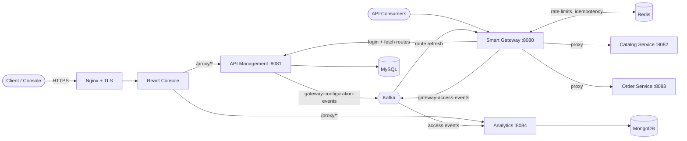

<div align="center">

# NexGate

**A custom API Gateway and API Management platform built from scratch with Java 21 and Spring Boot.**

Dynamic routing · JWT authentication · Rate limiting · Idempotency · Event-driven analytics


[Live Demo](https://nex-gate.dev) · [Architecture](#architecture) · [Quick Start](#quick-start) · [Deployment](#production-deployment-aws-ec2)

</div>

---

## Table of Contents

1. [Overview](#overview)
2. [Live Demo](#live-demo)
3. [Features](#features)
4. [Architecture](#architecture)
5. [Request Lifecycle](#request-lifecycle)
6. [Services](#services)
7. [Tech Stack](#tech-stack)
8. [Repository Structure](#repository-structure)
9. [Quick Start](#quick-start)
10. [Configuration](#configuration)
11. [Default Accounts and Security Hardening](#default-accounts-and-security-hardening)
12. [Frontend Console](#frontend-console)
13. [Production Deployment (AWS EC2)](#production-deployment-aws-ec2)
14. [Operations Runbook](#operations-runbook)
15. [Troubleshooting](#troubleshooting)
16. [Security Considerations](#security-considerations)
17. [Roadmap](#roadmap)
18. [Contributing](#contributing)
19. [License](#license)
20. [Author](#author)

---

## Overview

NexGate is a self-built API Gateway and API Management platform. It sits in front of downstream microservices and handles the cross-cutting concerns every API needs: authentication, authorization, routing, traffic control, request transformation and observability.

The project is deliberately built without an off-the-shelf gateway product. The goal is to understand and implement gateway architecture from first principles, with a focus on:

- Security (stateless JWT, role-based access, service-to-service identity)
- Scalability (stateless gateway, Redis-backed shared state, partitioned Kafka topics)
- Distributed systems (event-driven configuration propagation, eventual consistency)
- Microservice communication (reverse proxying, correlation IDs, health checks)

It consists of **five independent Spring Boot services**, a **shared `common` module**, and a **React management console**.

---

## Live Demo

| | |
|---|---|
| **URL** | https://nex-gate.dev |
| **Username** | `demouser1` |
| **Password** | `demouser1` |
| **Role** | Tenant Admin |

> `demouser1` is a **Tenant Admin** account: it can manage routes and policies for its own tenant. Accounts cannot be self-registered. In NexGate only the Platform Admin provisions users and tenants, which is why a shared demo login is provided. The environment is shared and public, so please read the [Demo Guidelines](#demo-guidelines) before experimenting.

### Demo Guidelines

The demo account exists so anyone can explore NexGate without installing anything.

**Please do**

- Browse the console, routes, policies and analytics.
- Send test traffic through the gateway and watch it appear in analytics.
- Create and edit routes that point to the bundled demo services (`catalog` and `order`), attach policies, and send traffic through the gateway.
- Found a bug or a security concern? Please report it (see [Contributing](#contributing)).

**Please don't**

- Change the demo account's password or delete shared data.
- Point routes at internal or private addresses, or at third-party sites you do not own, and never use the gateway to scan or attack anything. Activity is logged.
- Share the login with others publicly in bulk or automate sign-ins.
- Upload sensitive or personal data. Everything on the demo is visible to other visitors.
- Run load tests. The demo runs on a single small instance.

The demo database and analytics data may be reset at any time without notice. Abuse may result in the account being disabled.

---

## Features

### Smart Gateway
- **Dynamic routing**: routes are loaded from the management service and refreshed live over Kafka, with no restart or redeploy.
- **JWT authentication**: HS256 tokens validated at the edge, with issuer verification.
- **Rate limiting**: per-policy limits with counters stored in Redis, so limits hold across multiple gateway instances.
- **Idempotency**: repeated requests with the same idempotency key return the original result within a configurable TTL (default 24 h).
- **Request transformation**: header and request rewriting before forwarding.
- **Reverse proxying**: forwards to downstream services and returns structured JSON errors (for example `ROUTE_NOT_FOUND`).
- **Correlation IDs**: every response carries an `X-Correlation-ID` for end-to-end tracing.

### API Management
- Users, roles and tenant-aware accounts.
- Route and gateway policy management.
- Versioned gateway configuration, published to the gateway through events.
- Service-to-service authentication for the gateway (`GATEWAY_SERVICE` role).

### Analytics
- Consumes gateway access events from Kafka.
- Stores API usage statistics in MongoDB.

### Management Console
- React single-page app for operating the platform.
- Same-origin proxy design, so the backend needs no CORS configuration.

---

## Architecture



### Design decisions

| Decision | Reason |
|---|---|
| **Control plane and data plane are separate.** API Management owns configuration; the Gateway only serves traffic. | The gateway can scale independently and keeps serving traffic even if the admin API is briefly down. |
| **Configuration changes propagate through Kafka.** | The gateway refreshes routes without polling or restarts, and changes are decoupled from the admin request. |
| **Rate limit and idempotency state live in Redis.** | The gateway stays stateless, so multiple instances share the same counters and keys. |
| **Analytics is asynchronous.** | Logging an access event never adds latency to the request path. |
| **The gateway authenticates to management as a service account.** | Route data is only readable by the `GATEWAY_SERVICE` role. |
| **The console talks to the backend through a same-origin proxy.** | No CORS surface on any backend service. |

---

## Request Lifecycle

1. A client sends a request to the Smart Gateway.
2. The gateway assigns an `X-Correlation-ID`.
3. The JWT is validated (signature, issuer, expiry) and the caller's role is resolved.
4. The request path is matched against the active route table. No match returns `404 ROUTE_NOT_FOUND`.
5. The route's policies are applied: rate limit check (Redis), idempotency check (Redis), request transformation.
6. The request is proxied to the downstream service.
7. The response is returned to the client.
8. An access event is published to the `gateway-access-events` Kafka topic.
9. The Analytics service consumes the event and writes usage statistics to MongoDB.

Example error body:

```json
{
  "timestamp": "2026-11-25T12:50:14.842657339Z",
  "status": 404,
  "errorCode": "ROUTE_NOT_FOUND",
  "message": "No active route matches the request path",
  "path": "/",
  "correlationId": "8c126ed8-d024-489a-b28c-ae9b140c8de6"
}
```

---

## Services

| Service | Port | Datastore / Dependencies | Responsibility |
|---|---|---|---|
| `smart-gateway-service` | 8080 | Redis, Kafka, API Management | Routing, JWT auth, rate limiting, idempotency, transformation, proxying |
| `api-management-service` | 8081 | MySQL, Kafka | Users, roles, routes, policies, configuration versions, token issuing |
| `catalog-service` | 8082 | none | Demo downstream API (products) |
| `order-service` | 8083 | none | Demo downstream API (orders) |
| `analytics-service` | 8084 | MongoDB, Kafka | Consumes access events, stores usage statistics |
| `common` | n/a | n/a | Shared library module used by the services |

**Kafka topics** (created automatically by the `kafka-init` container, 3 partitions each):

| Topic | Producer | Consumer |
|---|---|---|
| `gateway-configuration-events` | API Management | Smart Gateway |
| `gateway-access-events` | Smart Gateway | Analytics |

**Health:** the management service exposes `GET /health`, which reports service and database status:

```json
{"serviceStatus":"UP","dbStatus":"UP","timestamp":"2026-11-25T12:45:00.449557419"}
```

---

## Tech Stack

| Layer | Technology |
|---|---|
| Language / Runtime | Java 21 |
| Framework | Spring Boot, Spring Security |
| Relational store | MySQL 8.4 (schema managed by versioned SQL migrations) |
| Document store | MongoDB 7.0 |
| Cache / shared state | Redis 7.4 |
| Messaging | Apache Kafka 7.7 (KRaft mode, no ZooKeeper) |
| Build | Maven (wrapper included) |
| Containers | Docker, Docker Compose |
| Frontend | React 19, TypeScript, Vite, Tailwind CSS, TanStack Query, React Router, React Hook Form, Zod, Recharts |

---

## Repository Structure

```
nexgate/
├── backend/
│   ├── smart-gateway-service/      # Data plane: routing, auth, rate limit, proxy
│   ├── api-management-service/     # Control plane: users, routes, policies
│   ├── analytics-service/          # Kafka consumer -> MongoDB
│   ├── catalog-service/            # Demo downstream service
│   ├── order-service/              # Demo downstream service
│   └── common/                     # Shared module
├── frontend/                       # React management console (Vite)
│   └── docs/
├── infrastructure/
│   ├── docker/compose.yaml         # Full local/production stack
│   └── kafka/                      # Kafka notes
├── .env.example                    # Environment template
├── pom.xml                         # Parent Maven build
├── mvnw / mvnw.cmd                 # Maven wrapper
└── README.md
```

---

## Quick Start

### Prerequisites

- Docker 24+ with the Compose plugin
- Node.js 20.19+ or 22 (frontend only)
- 8 GB RAM recommended (five JVMs plus Kafka and three datastores)

### 1. Clone

```bash
git clone https://github.com/rajanSoni0/nexgate.git
cd nexgate
```

### 2. Configure environment

```bash
cp .env.example .env
```

Then generate real secrets (see [Configuration](#configuration)):

```bash
sed -i "s|^NEXGATE_JWT_SECRET=.*|NEXGATE_JWT_SECRET=$(openssl rand -hex 32)|" .env
sed -i "s|^MYSQL_PASSWORD=.*|MYSQL_PASSWORD=$(openssl rand -hex 16)|" .env
sed -i "s|^MYSQL_ROOT_PASSWORD=.*|MYSQL_ROOT_PASSWORD=$(openssl rand -hex 16)|" .env
sed -i "s|^MONGO_ROOT_PASSWORD=.*|MONGO_ROOT_PASSWORD=$(openssl rand -hex 16)|" .env
```

Make sure `NEXGATE_GATEWAY_PASSWORD` is set exactly once. See the next section for how it ties to the seeded account.

### 3. Start the backend stack

The compose file lives in `infrastructure/docker/` but its build context is the repo root, so run it from the root with `--project-directory`:

```bash
docker compose --project-directory . -f infrastructure/docker/compose.yaml up -d --build
docker compose --project-directory . -f infrastructure/docker/compose.yaml ps
```

The first build downloads Maven dependencies and can take 10 to 20 minutes. On low-memory machines limit parallel builds:

```bash
export COMPOSE_PARALLEL_LIMIT=2
```

### 4. Verify

```bash
curl http://localhost:8081/health      # {"serviceStatus":"UP","dbStatus":"UP",...}
curl -i http://localhost:8080          # 404 ROUTE_NOT_FOUND (expected: no routes yet)
```

A `404 ROUTE_NOT_FOUND` from the gateway on a fresh install is the healthy state.

### 5. Run the frontend

```bash
cd frontend
npm ci
npm run dev          # development, http://localhost:5173
# or
npm run build && npm run preview -- --host 0.0.0.0 --port 4173
```

### Stop / reset

```bash
docker compose --project-directory . -f infrastructure/docker/compose.yaml down        # keep data
docker compose --project-directory . -f infrastructure/docker/compose.yaml down -v     # DELETE all data
```

---

## Configuration

All configuration is environment-driven. Copy `.env.example` to `.env`. **Never commit `.env`.**

| Variable | Required | Description |
|---|---|---|
| `NEXGATE_JWT_SECRET` | Yes | HS256 signing key shared by management, gateway and analytics. Minimum 32 bytes. |
| `NEXGATE_JWT_ISSUER` | No | Token issuer. Default `gatekeeper-api-management`. |
| `NEXGATE_GATEWAY_USERNAME` | No | Service account the gateway uses. Default `gateway-service`. |
| `NEXGATE_GATEWAY_PASSWORD` | Yes | Password for that service account. Must match the seeded account (see below). |
| `MYSQL_DATABASE` | No | Default `nexgate_management`. |
| `MYSQL_USER` / `MYSQL_PASSWORD` | No / Yes | Application database user. Must not be `root`. |
| `MYSQL_ROOT_PASSWORD` | Yes | MySQL root password. |
| `MONGO_DATABASE` | No | Default `nexgate_analytics`. |
| `MONGO_ROOT_USERNAME` / `MONGO_ROOT_PASSWORD` | No / Yes | MongoDB admin credentials. Use URL-safe values (hex is ideal). |
| `NEXGATE_IDEMPOTENCY_TTL_SECONDS` | No | Idempotency key lifetime. Default `86400`. |
| `NEXGATE_REDIS_URL` | No | Default `redis://redis:6379`. |
| `KAFKA_BOOTSTRAP_SERVERS` | No | Default `kafka:29092` (inside the Docker network). |
| `NEXGATE_MANAGEMENT_BASE_URL` | No | Default `http://api-management:8081`. |
| `nexgate.routing.allowed-internal-hosts` | No | Comma-separated internal hostnames that routes may target. Default `catalog,order`. All other private, loopback and link-local targets are rejected (SSRF protection). |

The compose file refuses to start if `NEXGATE_JWT_SECRET` or `NEXGATE_GATEWAY_PASSWORD` is unset.

---

## Default Accounts and Security Hardening

The schema migration `V3__seed_platform_accounts.sql` creates two accounts with **hardcoded BCrypt hashes**:

| Account | Role | Purpose |
|---|---|---|
| `platform-admin` | `PLATFORM_ADMIN` | Human administrator for the console |
| `gateway-service` | `GATEWAY_SERVICE` | Machine identity the gateway uses to fetch routes |

> **Because these hashes are committed to a public repository, treat the seeded passwords as publicly known. Replace them before exposing any instance to the internet.**

### Replacing the seeded hashes

Before the first start (the database must be empty, since migrations run once):

```bash
sudo apt install -y apache2-utils     # provides htpasswd

GW_PASS=$(grep '^NEXGATE_GATEWAY_PASSWORD=' .env | cut -d= -f2)
ADMIN_PASS=$(openssl rand -hex 12)
echo "PLATFORM_ADMIN_PASSWORD=$ADMIN_PASS" >> .env

GW_HASH=$(htpasswd -bnBC 10 "" "$GW_PASS"    | tr -d ':\n')
ADMIN_HASH=$(htpasswd -bnBC 10 "" "$ADMIN_PASS" | tr -d ':\n')
```

Then substitute the two hashes in
`backend/api-management-service/src/main/resources/db/migrations/V3__seed_platform_accounts.sql`
and build.

If the database already exists, do **not** edit the applied migration. Change the passwords through the application instead (or recreate the volume with `down -v` on a non-production instance).

The gateway's `NEXGATE_GATEWAY_PASSWORD` must be the plaintext of whichever hash is seeded for `gateway-service`. If they do not match, the gateway cannot fetch routes.

---

## Frontend Console

A React 19 + TypeScript single-page app in `frontend/`.

**Same-origin proxy.** The backend services have no CORS configuration by design. The browser only ever talks to its own origin, and the Vite dev/preview server forwards `/proxy/<service>/**` to the right backend:

| Browser path | Forwards to |
|---|---|
| `/proxy/management` | `VITE_MANAGEMENT_API_URL` (default `http://localhost:8081`) |
| `/proxy/gateway` | `VITE_GATEWAY_API_URL` (default `http://localhost:8080`) |
| `/proxy/analytics` | `VITE_ANALYTICS_API_URL` (default `http://localhost:8084`) |
| `/proxy/catalog` | `VITE_CATALOG_API_URL` (default `http://localhost:8082`) |
| `/proxy/order` | `VITE_ORDER_API_URL` (default `http://localhost:8083`) |

These variables are read by the Vite server, not by the browser. **Do not put credentials or tokens in them.**

Because the proxy is part of the Vite server, any deployment of the console must run `vite preview` (or replicate the same path mapping in the reverse proxy).

Scripts:

```bash
npm run dev         # dev server with hot reload
npm run build       # typecheck + production build into dist/
npm run preview     # serve dist/ with the proxy enabled
npm run typecheck
npm test
```

Further notes are in `frontend/docs/`.

---

## Production Deployment (AWS EC2)

This is the exact topology used for the live demo.

```
Internet ──443──> Nginx (TLS, Let's Encrypt) ──> Vite preview :4173 ──/proxy/*──> Docker services
```

| Component | Choice |
|---|---|
| Region | `ap-southeast-2` (Sydney) |
| Instance | `m7i-flex.large` (2 vCPU, 8 GB RAM), Ubuntu |
| Addressing | Elastic IP (stable across stop/start) |
| DNS | A record for `nex-gate.dev` at Name.com |
| TLS | Let's Encrypt via certbot, auto-renewed |
| Backend | Docker Compose |
| Frontend | `vite preview` managed by PM2 |
| Edge | Nginx reverse proxy on 80/443 |

### 1. Security group

| Port | Source | Purpose |
|---|---|---|
| 22 | Your IP `/32` | SSH |
| 80 | `0.0.0.0/0` | HTTP (redirects to HTTPS, ACME challenge) |
| 443 | `0.0.0.0/0` | HTTPS |

**Never expose** 3307 (MySQL), 27017 (MongoDB), 6379 (Redis), 9092 (Kafka), 8081 (management) or 8082 to 8084. Docker publishes these on the host, so the security group is the only barrier. Keep 8080 closed too unless you intentionally serve the gateway publicly.

### 2. Host preparation

```bash
sudo apt update && sudo apt upgrade -y
sudo apt install -y git curl docker.io docker-compose-v2 nginx

# 4 GB swap: five JVMs plus Kafka are tight on 8 GB
sudo fallocate -l 4G /swapfile && sudo chmod 600 /swapfile
sudo mkswap /swapfile && sudo swapon /swapfile
echo '/swapfile none swap sw 0 0' | sudo tee -a /etc/fstab

sudo usermod -aG docker $USER && newgrp docker
```

### 3. Backend

```bash
git clone https://github.com/rajanSoni0/nexgate.git && cd nexgate
# configure .env and harden seeded accounts (see sections above)
export COMPOSE_PARALLEL_LIMIT=2
docker compose --project-directory . -f infrastructure/docker/compose.yaml up -d --build

# survive reboots
docker update --restart unless-stopped $(docker ps -q)
```

### 4. Frontend

```bash
curl -fsSL https://deb.nodesource.com/setup_22.x | sudo -E bash -
sudo apt install -y nodejs
sudo npm install -g pm2

cd frontend
npm ci && npm run build
pm2 start npm --name nexgate-frontend -- run preview -- --host 0.0.0.0 --port 4173
pm2 save
pm2 startup        # run the printed sudo command
```

### 5. Nginx and TLS

`/etc/nginx/sites-available/nexgate`:

```nginx
server {
    listen 80;
    server_name nex-gate.dev www.nex-gate.dev;

    location / {
        proxy_pass http://localhost:4173;
        proxy_set_header Host localhost:4173;   # Vite preview rejects unknown hostnames
        proxy_set_header X-Real-IP $remote_addr;
        proxy_set_header X-Forwarded-For $proxy_add_x_forwarded_for;
        proxy_set_header X-Forwarded-Proto $scheme;
    }
}
```

```bash
sudo ln -s /etc/nginx/sites-available/nexgate /etc/nginx/sites-enabled/
sudo rm -f /etc/nginx/sites-enabled/default
sudo nginx -t && sudo systemctl restart nginx

sudo apt install -y certbot python3-certbot-nginx
sudo certbot --nginx -d nex-gate.dev -d www.nex-gate.dev
sudo certbot renew --dry-run
```

After HTTPS works, remove any security-group rule for port 4173.

> `.dev` is on the browser HSTS preload list, so it only loads over HTTPS. Test with `curl` before the certificate is issued.

---

## Operations Runbook

```bash
# Alias for convenience
alias nx='docker compose --project-directory ~/nexgate -f ~/nexgate/infrastructure/docker/compose.yaml'

nx ps                              # status
nx logs smart-gateway --tail=100   # logs (avoid -f in a shared terminal)
nx restart api-management          # restart one service
nx up -d --build                   # rebuild and apply changes

pm2 status                         # frontend
pm2 logs nexgate-frontend --lines 50 --nostream
pm2 restart nexgate-frontend

docker stats --no-stream           # per-container memory
free -h                            # host memory and swap
```

### Updating to a new version

```bash
cd ~/nexgate
git pull
nx up -d --build
cd frontend && npm ci && npm run build && pm2 restart nexgate-frontend
```

If you carry local changes (for example custom seed hashes), `git stash` before pulling and `git stash pop` after.

### Backups

- **Secrets:** keep `.env` in a password manager and an offline copy. It is not in Git.
- **MySQL:** `nx exec mysql sh -c 'mysqldump -u root -p"$MYSQL_ROOT_PASSWORD" nexgate_management' > backup.sql`
- **MongoDB:** `nx exec mongodb mongodump --archive --username root --password <pw> --authenticationDatabase admin > mongo.archive`

Named volumes (`mysql-data`, `mongo-data`, `redis-data`, `kafka-data`) persist across `down` but **not** across `down -v`.

---

## Troubleshooting

| Symptom | Likely cause | Fix |
|---|---|---|
| `docker compose` complains `set NEXGATE_JWT_SECRET` | Missing `.env` values | Fill `NEXGATE_JWT_SECRET` and `NEXGATE_GATEWAY_PASSWORD` |
| Build fails with "Dockerfile not found" | Ran compose from the wrong directory | Run from repo root with `--project-directory .` |
| Gateway never starts | `api-management` not healthy yet | `nx logs api-management --tail=100` |
| Gateway logs 401 against management | `NEXGATE_GATEWAY_PASSWORD` does not match the seeded hash | Re-hash and reseed (see [hardening](#default-accounts-and-security-hardening)) |
| Containers `Killed` / OOM | Not enough RAM | Add swap, limit `COMPOSE_PARALLEL_LIMIT`, check `docker stats` |
| Gateway returns `404 ROUTE_NOT_FOUND` | No active route matches the path | Expected on a fresh install; create a route |
| `vite: not found` | `node_modules` missing | `npm ci` in `frontend/` |
| Console loads but API calls fail | Preview server not running, or backend down | `pm2 status`, `nx ps` |
| `Blocked request. This host is not allowed` | Vite host check behind a domain | Keep `proxy_set_header Host localhost:4173` in Nginx |
| Site unreachable after reboot | Restart policy or PM2 startup not configured | `docker update --restart unless-stopped ...`, `pm2 startup` + `pm2 save` |
| SSH `Connection timed out` | Your public IP changed | Update the port 22 rule with the new IP |
| certbot fails | DNS not propagated, or port 80 closed | `nslookup nex-gate.dev`, check security group |

---

## Security Considerations

- **Rotate seeded credentials** before any public deployment. See [above](#default-accounts-and-security-hardening).
- **Use a strong, unique `NEXGATE_JWT_SECRET`.** Anyone holding it can mint valid tokens for every service.
- **Keep datastores private.** Never open database or Kafka ports to the internet.
- **Terminate TLS at the edge.** Credentials and tokens travel in requests; do not serve the console over plain HTTP.
- **Route targets are a trust boundary.** A tenant admin chooses where the gateway forwards traffic. Without validation this becomes a server-side request forgery (SSRF) path to internal services (databases, the management API, the cloud metadata endpoint). Validate route upstreams against an allow-list, and reject loopback, private and link-local ranges after DNS resolution.
- **Shared demo accounts are least-privilege and disposable.** The public demo uses a Tenant Admin account scoped to its own tenant. It cannot create users or tenants, and its data may be reset at any time.
- **Harden the host:** require IMDSv2 on the EC2 instance with a hop limit of 1, and keep datastores unreachable from the internet.
- **Secrets stay out of Git.** `.env` is ignored; never paste its contents into issues, chats or logs.
- Report vulnerabilities privately to the maintainer rather than opening a public issue.

---

## Roadmap

- [ ] `restart: unless-stopped` policies and healthchecks for every service in `compose.yaml`
- [ ] Seed account passwords supplied through environment instead of committed hashes
- [ ] Containerized frontend served by Nginx (removes the Vite preview dependency)
- [ ] CI pipeline (build, test, image publishing)
- [ ] Observability: Prometheus metrics and distributed tracing
- [ ] Multi-instance gateway behind a load balancer
- [ ] Token refresh and revocation

---

## Contributing

Issues and pull requests are welcome.

1. Fork the repository and create a feature branch: `git checkout -b feature/my-change`
2. Make your change with tests where applicable (`./mvnw test`, `npm test`)
3. Commit with a clear message and open a pull request describing what and why

---

## License

This project is open source and licensed under the [MIT License](LICENSE).

You are free to use, copy, modify, merge, publish, distribute, sublicense and sell copies of this software, for personal or commercial purposes. The only requirement is that the copyright notice and license text are included in all copies or substantial portions of the software.

The software is provided "as is", without warranty of any kind.

---

## Author

**Rajan Soni** · [GitHub](https://github.com/rajanSoni0)

If you find this project useful, consider giving it a star.
