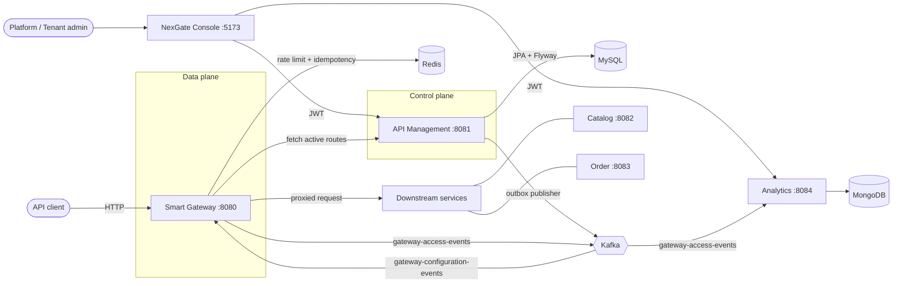

# NexGate

**A multi-tenant API gateway and API management platform built with Java 21, Spring Boot 3 and React.**

NexGate lets platform operators onboard organizations, and lets each organization publish and govern its own API routes: authentication, role-based access, rate limiting, idempotency, timeouts, path rewriting and header transformation. Every route change is versioned, audited and pushed to the running gateway in near real time, without a restart.

---

## Demo Account

You can explore the NexGate Console using the following demo credentials:

| Field | Value |
|---|---|
| Username | `demouser1` |
| Password | `demouser1` |

**Login:** https://nex-gate.dev/

> **Note:** This is a demo account intended for evaluation and exploration. Please do not use these credentials for sensitive activities.

---

## Table of contents

- [Highlights](#highlights)
- [Architecture](#architecture)
- [Features](#features)
  - [Smart Gateway (data plane)](#smart-gateway-data-plane)
  - [API Management (control plane)](#api-management-control-plane)
  - [Analytics](#analytics)
  - [NexGate Console (web UI)](#nexgate-console-web-ui)
  - [Demo services](#demo-services)
- [Roles and access](#roles-and-access)
- [Tech stack](#tech-stack)
- [Getting started](#getting-started)
- [End-to-end walkthrough](#end-to-end-walkthrough)
- [API reference](#api-reference)
- [Configuration](#configuration)
- [Testing](#testing)
- [Project structure](#project-structure)
- [Known limitations](#known-limitations)

---

## Highlights

- **Dynamic routing** with exact, path-variable and wildcard patterns, resolved by specificity.
- **Per-route policies** configured from the UI or API: JWT auth and roles, Redis rate limiting, POST idempotency, timeouts, path rewriting, header rules.
- **Hot configuration reload.** Changes flow through a transactional outbox to Kafka, and the gateway refreshes its route table without downtime.
- **Multi-tenancy** with strict tenant isolation enforced server-side.
- **Full route version history** with snapshots, field-level comparison and one-click restore.
- **Audit trail** for every administrative route operation.
- **Event-driven analytics** from gateway access events into MongoDB.
- **Tested.** Backend unit and integration tests per service, plus 86 frontend tests.

---

## Architecture

NexGate separates the **control plane** (where routes are defined) from the **data plane** (where traffic flows).



| Module | Port | Responsibility | Data store |
|---|---|---|---|
| `api-management-service` | 8081 | Control plane: authentication, organizations, tenant admins, routes, policies, versions, audit | MySQL |
| `smart-gateway-service` | 8080 | Data plane: route matching, auth, policies, proxying, access events | Redis (in-memory route table) |
| `analytics-service` | 8084 | Consumes access events and serves traffic statistics | MongoDB |
| `catalog-service` | 8082 | Demo downstream service (products) | In memory |
| `order-service` | 8083 | Demo downstream service (orders) | In memory |
| `common` | , | Shared, dependency-light event contracts | , |
| `frontend` | 5173 | NexGate Console (React admin UI) | , |

**How a configuration change reaches the gateway**

1. An admin creates or edits a route in API Management.
2. In the same database transaction, a version snapshot and an **outbox** row are written (no lost events).
3. A scheduler publishes pending outbox rows to the `gateway-configuration-events` Kafka topic.
4. The gateway receives the event, fetches the authoritative active-route list from API Management, validates it and atomically swaps its in-memory registry.

---

## Features

### Smart Gateway (data plane)

**Routing and matching**
- Matches on HTTP method and path against the in-memory route registry.
- Supported patterns: exact (`/orders/list`), path variables (`/orders/{id}`), single-segment wildcard (`/orders/*`) and multi-segment wildcard (`/orders/**`).
- When several routes match, the **most specific wins** (exact > path variable > `/*` > `/**`).
- Distinguishes `404 ROUTE_NOT_FOUND` from `405 METHOD_NOT_ALLOWED` (path matches, method does not).
- Rejects duplicate method-and-path registrations when loading a configuration.

**Path handling**
- **Strip prefix:** forward only the part of the path after the matched prefix.
- **Path rewriting:** replace the matched prefix with a configured target prefix (for example `/catalog/**` to `/api/catalog/**`).
- Target base paths are joined safely, and query strings are preserved.

**Authentication and authorization**
- Validates **HS256 JWTs locally**, with no call to the control plane per request. Checks signature, expiry, issuer and subject.
- Reads roles from the `role` claim and/or a `roles` claim (string or list).
- Per-route policy: public, or authentication required with a list of permitted roles.
- Returns `401` (`MISSING_JWT` / `INVALID_JWT`) or `403` (`INSUFFICIENT_ROLE`).
- A protected route with no permitted roles denies everyone.

**Rate limiting**
- Redis-backed **fixed-window counter**, executed atomically through a Lua script.
- Configurable per route: request count, window in seconds and scope.
- Scopes: `ROUTE`, `USER` (JWT subject), `TENANT` (route organization), `IP` (remote address).
- Keys include organization, route, scope, identity and window bucket.
- Returns `429 RATE_LIMIT_EXCEEDED` with a `Retry-After` header.
- **Fails closed**: if Redis is unavailable, rate-limited routes return `503 RATE_LIMIT_STORE_UNAVAILABLE`.

**POST idempotency**
- Routes can require an `Idempotency-Key` header on POST requests.
- Records are keyed by organization, route and key, and stored in Redis with a TTL (default 24 h).
- A completed request is **replayed** (status, body and headers) for the same key and payload.
- Concurrent duplicates, or the same key with a different payload, return `409 IDEMPOTENCY_CONFLICT`.
- A missing key returns `400`. Store failures return `503`.
- Abandons the key if the downstream call fails, so the client can safely retry.

**Header transformation**
- Rules apply to the request or the response, with actions `ADD`, `MODIFY`, `REMOVE` and `FORWARD`.
- Hop-by-hop headers are always stripped.
- `Authorization` and `Cookie` are not forwarded downstream. Header rules naming `Authorization`, `Cookie` or `Set-Cookie` are rejected at configuration time.

**Resilience and error handling**
- Per-route timeout (1 ms to 300,000 ms) enforced on the downstream call.
- Structured error responses with stable codes: `DOWNSTREAM_TIMEOUT` (504), `TARGET_CONNECTION_FAILURE` / `TARGET_UNAVAILABLE` (502), `INVALID_TARGET_CONFIGURATION` (502), `GATEWAY_INTERNAL_ERROR` (500).
- **Last-known-good registry:** if a refresh fails or is rejected, the gateway keeps serving the previous configuration and marks itself degraded.
- Startup loads routes from API Management with retries (default 30 attempts, 2 s apart) before refusing to start.
- Refresh events are validated and de-duplicated by route version, so duplicate or out-of-order notifications are ignored.

**Observability**
- **Correlation IDs:** accepts a valid incoming `X-Correlation-ID` (or generates a UUID), forwards it downstream and returns it on the response.
- **Access events:** every request (including rate-limit rejections and idempotency replays) is published to Kafka with route, method, status, outcome and duration.
- Route-registry and Kafka-refresh health indicators on `/actuator/health`.

### API Management (control plane)

**Authentication**
- `POST /api/auth/login` issues a signed HS256 JWT (`sub`, `role`, `iat`, `exp`, optional `organizationId`, issuer `gatekeeper-api-management`).
- Passwords hashed with BCrypt. Stateless sessions, with a configurable token lifetime (default 3600 s).
- Tenant logins are refused while the organization is not `ACTIVE`.

**Organizations (multi-tenancy)**
- Create, list, view, update and delete organizations, each with a unique lowercase slug.
- Lifecycle: `PENDING` (on creation), `ACTIVE`, `SUSPENDED`, `DELETED`.
- Deletion is **soft**: the organization is hidden from queries but retained.
- Manage the organization's **tenant administrator** (one per organization): create, view, update, enable/disable and delete.

**Route management**
- Full CRUD for routes: identifier, name, description, path pattern, target URI, strip-prefix, allowed methods and active flag.
- Activate or deactivate a route without deleting it.
- Paged route listing with an `active` filter and sorting.
- Soft delete, with history preserved.
- Route identifiers are unique per organization.

**Route policies**
- Authentication required and permitted roles.
- Rate limit (requests, window, scope).
- Timeout.
- POST idempotency.
- Path rewrite target prefix.
- Request and response header rules.
- Policy-only updates through a dedicated endpoint.

**Validation**
- Target must be an absolute HTTP(S) URI.
- Path pattern must start with `/`.
- Methods restricted to `GET POST PUT PATCH DELETE HEAD OPTIONS`.
- Idempotency requires `POST` among the allowed methods.
- Rate-limit values and timeout must be in range.
- Permitted roles must be known application roles.
- `ADD` and `MODIFY` header rules require a value.

**Versioning**
- Every change creates a numbered **immutable snapshot** recording the change type, author and time (`CREATE`, `UPDATE`, `POLICY_UPDATE`, `ACTIVATE`, `DEACTIVATE`, `DELETE`, `RESTORE:<n>`).
- **Compare** any two versions with field-level differences.
- **Restore** any earlier version. A restore creates a new version rather than rewriting history, and the snapshot is re-validated first.

**Tenant isolation**
- Tenant admins can only read and modify routes in their own organization, derived from the JWT `organizationId` claim.
- Cross-tenant access returns `403`. Platform admins can see across organizations.

**Reliability and governance**
- **Transactional outbox:** route changes are written atomically with their outbox event, then published to Kafka by a scheduled publisher (retries up to 10 times, then marks the event `FAILED`).
- **Audit logging:** an `@Audited` aspect records actor, action, resource, result, duration and timestamp for route operations in `control_plane_audit_records`.
- **Flyway migrations** manage the MySQL schema, with Hibernate set to `validate`.
- Consistent JSON error responses through a global exception handler.
- Public `/health` endpoint with database status.

### Analytics

- Consumes `gateway-access-events` from Kafka and stores them in MongoDB.
- **Idempotent ingestion** by `eventId` (unique index), so redelivered events are not double counted.
- Restricted to `PLATFORM_ADMIN` (statistics span all tenants), validated with the shared JWT secret and issuer.

| Endpoint | Returns |
|---|---|
| `GET /api/analytics/summary` | Total, successful and failed requests, average response time |
| `GET /api/analytics/routes` | Per-route request count and average response time |
| `GET /api/analytics/slow-routes?limit=10` | Slowest routes by average response time |
| `GET /api/analytics/rate-limit-rejections` | Count of rate-limited requests |
| `GET /api/analytics/idempotency-replays` | Count of replayed idempotent requests |

### NexGate Console (web UI)

A React single-page admin console with role-specific navigation.

**Platform admin**
- Platform overview.
- Organizations: list, search, filter by status, create (slug auto-suggested), edit, change status (with confirmation) and delete (type the slug to confirm).
- Tenant administrators: create, view, edit, enable or disable and delete, one organization at a time.
- Read-only route oversight across organizations, with a configuration-versions index.
- Platform analytics: charts for summary, per-route, slow-route, rate-limit and idempotency metrics.
- **Service health** and **infrastructure health** dashboards that probe each service.
- Audit logs and settings pages.

**Tenant admin**
- Tenant overview.
- Route management: create, edit, activate or deactivate and delete.
- Visual **route pipeline** showing how each policy applies to a request.
- Policy editor: authentication and roles, rate limit, timeout, idempotency, rewrite and header rules.
- Version history: compare two versions, inspect snapshots and restore.
- Organization details and profile.

**Console behavior**
- Light, dark and system themes.
- Form validation that mirrors backend rules (React Hook Form + Zod), with server conflicts mapped back onto the right field.
- Session token kept in `sessionStorage` only (never `localStorage`, never logged), with an expiry warning two minutes before sign-out.
- The token is attached only to API Management and Analytics requests, never to the gateway or demo services.
- Role guards in the UI. Spring Security remains the authorization boundary.
- Query cache cleared on sign-out so one user's data never appears for the next.
- Clear, honest states for unavailable backend capabilities instead of placeholder data.

### Demo services

Two small downstream services for trying the gateway end to end.

- **Catalog** (`:8082`): list and fetch products, create a product, plus a `/api/catalog/delay?ms=` endpoint for testing timeouts.
- **Order** (`:8083`): create, fetch and list orders, plus `/api/orders/delay?ms=`.

---

## Roles and access

| Role | Purpose | Can access |
|---|---|---|
| `PLATFORM_ADMIN` | Operates the platform | `/api/platform/**`, `/api/gateway/admin/**` (all organizations), `/api/analytics/**` |
| `TENANT_ADMIN` | Manages one organization's APIs | `/api/gateway/admin/**` (own organization only) |
| `GATEWAY_SERVICE` | Service account used by the gateway | `GET /api/gateway/routes` (active routes). Cannot sign in to the console. |

Application roles accepted in route policies: `PLATFORM_ADMIN`, `TENANT_ADMIN`, `GATEWAY_SERVICE`, `USER`, `ADMIN`.

---

## Tech stack

| Layer | Technology |
|---|---|
| Backend | Java 21, Spring Boot 3.5, Spring Security (OAuth2 resource server / JWT), Spring Data JPA, Spring Data MongoDB, Spring Kafka, Spring AOP |
| Data | MySQL 8.4 (Flyway), MongoDB 7, Redis 7.4 |
| Messaging | Apache Kafka (KRaft mode, Confluent 7.7) |
| Frontend | React 19, TypeScript, Vite, Tailwind CSS 4, React Router 7, TanStack Query, React Hook Form, Zod, Recharts, Lucide |
| Testing | JUnit, Spring Boot Test, Testcontainers, Vitest, React Testing Library |
| Build and run | Maven (multi-module with wrapper), Docker, Docker Compose |

---

## Getting started

### Prerequisites

- JDK 21 (to build and run outside Docker)
- Docker and Docker Compose
- Node.js `^20.19.0` or `>=22.12.0` and npm 10+ (for the console)

### 1. Configure the environment

```bash
cp .env.example .env
```

At minimum, set a strong `NEXGATE_JWT_SECRET` (HS256, **at least 32 bytes**) and `NEXGATE_GATEWAY_PASSWORD`. See [Configuration](#configuration).

### 2. Start the backend stack

```bash
docker compose -f infrastructure/docker/compose.yaml --env-file .env up --build
```

This starts MySQL, MongoDB, Redis, Kafka, the two Kafka topics (`gateway-access-events`, `gateway-configuration-events`), API Management, Smart Gateway, Analytics, Catalog and Order. The gateway waits for API Management to be healthy.

### 3. Start the console

```bash
cd frontend
npm ci
cp .env.example .env.local   # only if your service ports differ
npm run dev
```

Open <http://localhost:5173> and sign in with an administrator account.

> The backend has no CORS configuration, so the console calls same-origin `/proxy/<service>/**` paths and the Vite dev and preview servers forward them to each service. See `frontend/README.md` for details.

### Running services individually

```bash
./mvnw clean test
./mvnw spring-boot:run -pl backend/api-management-service
./mvnw spring-boot:run -pl backend/smart-gateway-service
./mvnw spring-boot:run -pl backend/analytics-service
./mvnw spring-boot:run -pl backend/catalog-service
./mvnw spring-boot:run -pl backend/order-service
```

On Windows use `mvnw.cmd`. Health endpoints are at `/actuator/health` on each service (and `/health` on API Management).

### Frontend commands

| Command | Description |
|---|---|
| `npm run dev` | Dev server with backend proxy (port 5173) |
| `npm run build` | Type-check and production build |
| `npm run preview` | Serve the build with the same proxy (port 4173) |
| `npm test` | Run the Vitest suite |
| `npm run typecheck` | Type-check only |

---

## End-to-end walkthrough

A minimal tour: onboard a tenant, publish a route and call it through the gateway. (On Windows PowerShell, use `curl.exe`.)

**1. Sign in as platform admin**

```bash
curl -s -X POST http://localhost:8081/api/auth/login \
  -H "Content-Type: application/json" \
  -d '{"username":"platform-admin","password":"<your-platform-admin-password>"}'
# copy the "token" value into $PLATFORM_TOKEN
```

**2. Create and activate an organization**

```bash
curl -s -X POST http://localhost:8081/api/platform/organizations \
  -H "Authorization: Bearer $PLATFORM_TOKEN" -H "Content-Type: application/json" \
  -d '{"name":"Acme Corp","slug":"acme"}'          # created as PENDING

curl -s -X PATCH http://localhost:8081/api/platform/organizations/1/status \
  -H "Authorization: Bearer $PLATFORM_TOKEN" -H "Content-Type: application/json" \
  -d '{"status":"ACTIVE"}'
```

**3. Create the tenant administrator and sign in as them**

```bash
curl -s -X POST http://localhost:8081/api/platform/organizations/1/tenant-admin \
  -H "Authorization: Bearer $PLATFORM_TOKEN" -H "Content-Type: application/json" \
  -d '{"username":"acme-admin","password":"a-strong-password","enabled":true}'

curl -s -X POST http://localhost:8081/api/auth/login \
  -H "Content-Type: application/json" \
  -d '{"username":"acme-admin","password":"a-strong-password"}'
# copy the token into $TENANT_TOKEN
```

**4. Publish a route to the demo catalog service**

```bash
curl -s -X POST http://localhost:8081/api/gateway/admin/routes \
  -H "Authorization: Bearer $TENANT_TOKEN" -H "Content-Type: application/json" \
  -d '{
    "routeId": "catalog",
    "name": "Catalog API",
    "pathPattern": "/catalog/**",
    "targetUri": "http://catalog:8082",
    "stripPrefix": false,
    "allowedMethods": ["GET", "POST"],
    "active": true,
    "policy": {
      "authenticationRequired": false,
      "permittedRoles": [],
      "rateLimitEnabled": true,
      "rateLimitRequests": 5,
      "rateLimitWindowSeconds": 60,
      "rateLimitScope": "IP",
      "timeoutMs": 5000,
      "idempotencyEnabled": false,
      "rewriteEnabled": true,
      "rewriteTargetPrefix": "/api/catalog"
    },
    "headerRules": []
  }'
```

**5. Call it through the gateway** (the route is picked up within seconds via Kafka)

```bash
curl -i http://localhost:8080/catalog/products
```

Send more than five requests in a minute to see `429 RATE_LIMIT_EXCEEDED` with a `Retry-After` header.

---

## API reference

### API Management (`:8081`)

| Method | Path | Access | Description |
|---|---|---|---|
| POST | `/api/auth/login` | Public | Sign in and receive a JWT |
| GET | `/health` | Public | Service and database status |
| POST / GET | `/api/platform/organizations` | Platform admin | Create / list organizations |
| GET / PUT / DELETE | `/api/platform/organizations/{id}` | Platform admin | View / update / soft-delete |
| PATCH | `/api/platform/organizations/{id}/status` | Platform admin | Change organization status |
| POST / GET / PUT / DELETE | `/api/platform/organizations/{id}/tenant-admin` | Platform admin | Manage tenant administrator |
| POST / GET | `/api/gateway/admin/routes` | Platform or tenant admin | Create / list routes (paged, `active` filter) |
| GET / PUT / DELETE | `/api/gateway/admin/routes/{id}` | Platform or tenant admin | View / update / soft-delete a route |
| PATCH | `/api/gateway/admin/routes/{id}/status` | Platform or tenant admin | Activate or deactivate |
| GET / PUT | `/api/gateway/admin/routes/{id}/policy` | Platform or tenant admin | Read / update policy |
| GET | `/api/gateway/admin/routes/{id}/versions` | Platform or tenant admin | Version history |
| GET | `/api/gateway/admin/routes/{id}/versions/{v}` | Platform or tenant admin | One version snapshot |
| GET | `/api/gateway/admin/routes/{id}/versions/compare?from=&to=` | Platform or tenant admin | Compare two versions |
| POST | `/api/gateway/admin/routes/{id}/versions/{v}/restore` | Platform or tenant admin | Restore a version |
| GET | `/api/gateway/routes` | Gateway service | Active routes for the gateway |

### Gateway error codes (`:8080`)

| Status | Code | Meaning |
|---|---|---|
| 400 | `IDEMPOTENCY_KEY_REQUIRED` | POST to an idempotent route without `Idempotency-Key` |
| 401 | `MISSING_JWT` / `INVALID_JWT` | No token, or the token is invalid or expired |
| 403 | `INSUFFICIENT_ROLE` | Authenticated but not permitted for this route |
| 404 | `ROUTE_NOT_FOUND` | No active route matches the path |
| 405 | `METHOD_NOT_ALLOWED` | Path matches, method not allowed |
| 409 | `IDEMPOTENCY_CONFLICT` | Key in progress, or reused with a different payload |
| 429 | `RATE_LIMIT_EXCEEDED` | Rate limit hit (see `Retry-After`) |
| 502 | `TARGET_CONNECTION_FAILURE`, `TARGET_UNAVAILABLE`, `INVALID_TARGET_CONFIGURATION` | Downstream problem |
| 503 | `RATE_LIMIT_STORE_UNAVAILABLE`, `IDEMPOTENCY_STORE_UNAVAILABLE` | Redis unavailable (fails closed) |
| 504 | `DOWNSTREAM_TIMEOUT` | Downstream exceeded the route timeout |

### Demo services

| Service | Endpoints |
|---|---|
| Catalog (`:8082`) | `GET /api/catalog/products`, `GET /api/catalog/products/{id}`, `POST /api/catalog/products`, `GET /api/catalog/delay?ms=` |
| Order (`:8083`) | `POST /api/orders`, `GET /api/orders`, `GET /api/orders/{id}`, `GET /api/orders/delay?ms=` |

---

## Configuration

Key environment variables (see `.env.example` for the full list):

| Variable | Purpose |
|---|---|
| `NEXGATE_JWT_SECRET` | Shared HS256 secret (>= 32 bytes) used by API Management, Gateway and Analytics |
| `NEXGATE_JWT_ISSUER` | Expected token issuer (default `gatekeeper-api-management`) |
| `NEXGATE_JWT_EXPIRATION_SECONDS` | Token lifetime (default `3600`) |
| `NEXGATE_GATEWAY_USERNAME` / `NEXGATE_GATEWAY_PASSWORD` | Credentials the gateway uses to fetch routes from API Management |
| `NEXGATE_MANAGEMENT_BASE_URL` | API Management URL as seen by the gateway |
| `NEXGATE_REDIS_URL` | Redis connection URL for rate limiting and idempotency |
| `NEXGATE_IDEMPOTENCY_TTL_SECONDS` | Idempotency record lifetime (default `86400`) |
| `NEXGATE_OUTBOX_PUBLISH_DELAY_MS` | Outbox publisher interval (default `5000`) |
| `NEXGATE_MYSQL_URL` / `_USERNAME` / `_PASSWORD` | API Management database |
| `NEXGATE_MONGODB_URI` | Analytics database |
| `KAFKA_BOOTSTRAP_SERVERS` | Kafka brokers |
| `VITE_*_API_URL` | Console dev-proxy upstreams (frontend `.env.local`) |

> **Security:** never commit `.env`. Replace every `change-me` value, and change the passwords of the accounts seeded by the Flyway migrations before any real deployment.

---

## Testing

```bash
./mvnw clean test            # all backend modules
cd frontend && npm test      # 86 frontend tests
```

- **Gateway:** route matching, registry, path and header transformation, proxy forwarder, JWT validation, authorization, Redis rate limiting and idempotency, Kafka refresh listener, correlation IDs, error handling and a full security-pipeline integration test.
- **API Management:** policy validation, version comparison, tenant authorization, audit aspect, outbox publisher and route-management integration tests.
- **Analytics:** event processing, statistics, controller and security tests.
- **Demo services:** controller tests.
- **Console:** authentication and session handling, role guards, form validation, organizations, tenant admins, routes (create, policy, versions, restore, paging), analytics states and health classification.

---

## Project structure

```text
nexgate/
├── backend/
│   ├── api-management-service/   Control plane (MySQL, Flyway, outbox, audit)
│   ├── smart-gateway-service/    Data plane (routing, auth, rate limit, idempotency, proxy)
│   ├── analytics-service/        Kafka consumer + MongoDB statistics
│   ├── catalog-service/          Demo downstream service
│   ├── order-service/            Demo downstream service
│   └── common/                   Shared event contracts
├── frontend/                     NexGate Console (React + TypeScript + Vite)
│   └── docs/INTEGRATION_CHECKLIST.md
├── infrastructure/
│   ├── docker/compose.yaml       Full local stack
│   └── kafka/                    Topic initialization notes
├── .env.example
└── pom.xml                       Maven parent (multi-module)
```

---

## Known limitations

- **Audit log viewer:** audit records are written to MySQL, but no API endpoint exposes them yet, so the console explains what is recorded instead of showing a table.
- **Tenant analytics:** analytics endpoints are platform-wide and have no organization filter, so tenant analytics pages are intentionally withheld to avoid leaking other tenants' traffic.
- **Analytics queries** have no time-range parameters; only overall aggregates are available.
- **Tenant admin updates** always require a new password (the request validates it as mandatory).
- **No token refresh:** sessions end at token expiry.
- **Console deployment** uses the Vite dev or preview server for the same-origin proxy. Serving `dist/` elsewhere needs an equivalent reverse proxy or CORS on the backend.
- **Authorization forwarding** to downstream services is not configurable, because header rules naming `Authorization` are rejected.

---

## Author

Built by [Rajan Soni](https://github.com/rajanSoni0).